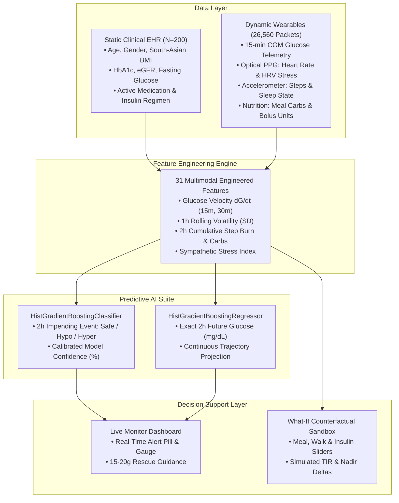

# 🧬 GlycoTwin: Multimodal Digital Twin for Type 2 Diabetes Management
### *Predicting Acute Adverse Glycemic Events 2 Hours in Advance with Counterfactual Simulation*

[](https://glycotwin-app.web.app)
[](LICENSE)
[](https://python.org)
[](https://happiesthealth.com)

> **Official Prototype & Code Submission for Phase 1**  
> **Happiest Health Reimagining and Reforming Healthcare in India Summit - 2026, Bengaluru**  
> 🌐 **Public Live URL:** [https://glycotwin-app.web.app](https://glycotwin-app.web.app) *(Hosted on Global Edge CDN)*

---

## 📋 Table of Submission Sections

1. [📌 Team Details & College / Incubator Information](#1--team-details--college--incubator-information)
2. [🏷️ Project Title](#2-️-project-title)
3. [🎯 Problem Statement & Healthcare Use Case](#3--problem-statement--healthcare-use-case)
4. [💻 Technical Stack, AI/ML Model & Framework Details](#4--technical-stack-aiml-model--framework-details)
5. [📹 Minimum 20-Minute Video Demonstration](#5--minimum-20-minute-video-demonstration)
6. [📄 Open-Source License Details](#6--open-source-license-details)
7. [📐 Architecture Diagram in PDF / PPT Format](#7--architecture-diagram-in-pdf--ppt-format)
8. [📊 Presentation in PDF / PPT Format (Details & Outcomes)](#8--presentation-in-pdf--ppt-format-details--outcomes)
9. [🚀 Quick Start Guide (Run Locally or Online)](#9--quick-start-guide-run-locally-or-online)

---

## 1. 📌 Team Details & College / Incubator Information

| Detail | Information |
| :--- | :--- |
| **Team Name** | **Classy Leopards** |
| **College / University** | **Goa Institute of Management, Sanquelim, Goa, India** |
| **Team Leader** | **Shivam Raj** ([shivam.raj2026h@gim.ac.in](mailto:shivam.raj2026h@gim.ac.in) \| +91-6386147295) |
| **Team Member 2** | **Shubham Kumar** ([shubham.kumar2026h@gim.ac.in](mailto:shubham.kumar2026h@gim.ac.in)) |
| **Team Member 3** | **Shiva Kumar Bachatty** ([shivakumar.bachatty@gim.ac.in](mailto:shivakumar.bachatty@gim.ac.in)) |
| **Team Member 4** | **Yashita Dube** ([yashita.dubey2026h@gim.ac.in](mailto:yashita.dubey2026h@gim.ac.in)) |
| **GitHub Repository** | [https://github.com/kumarshubhammorya/glycotwin-digital-twin](https://github.com/kumarshubhammorya/glycotwin-digital-twin) |

---

## 2. 🏷️ Project Title

**GlycoTwin: Multimodal Digital Twin for Type 2 Diabetes Management**  
*Sub-title:* **Predicting Acute Adverse Glycemic Events 2 Hours in Advance with Counterfactual Intervention Simulation**

---

## 3. 🎯 Problem Statement & Healthcare Use Case

### The Crisis in India
India is recognized globally as the **"Diabetes Capital of the World"**:
* **101 Million+ Citizens** currently live with Type 2 Diabetes (T2D), and an additional **136 million** are pre-diabetic.
* **The South-Asian Phenotype:** Unlike Western populations who develop diabetes at BMI $>28\text{ kg/m}^2$, Indians develop severe insulin resistance at lower body mass index thresholds ($\text{BMI } 22\text{--}24\text{ kg/m}^2$) paired with high visceral adiposity and carbohydrate-dense diets (white rice, rotis, festive sweets).

### The Failure of Episodic Care
Current chronic diabetes management is entirely **reactive**:
1. **The 4-to-6 Hour Blind Window:** Patients test blood sugar with finger pricks only 1–3 times a day. Between tests, blood sugar swings wildly without warning.
2. **Acute Severe Hypoglycemia ($< 70\text{ mg/dL}$):** The brain is starved of glucose, triggering neuroglycopenic symptoms, confusion, loss of consciousness, falls, fractures, or fatal comas—especially dangerous in elderly patients and those on insulin or sulfonylureas.
3. **Severe Hyperglycemic Spikes ($> 250\text{ mg/dL}$):** Accelerates macro- and micro-vascular tissue damage, leading to diabetic retinopathy (blindness), nephropathy (kidney failure), and cardiovascular arrest.

### The GlycoTwin Solution
GlycoTwin transitions diabetes care from **retrospective reaction** to **continuous proactive prediction**:
* **Virtual Metabolic Replica:** Dynamically fuses patient medical history (EHR) with real-time wearable streams (CGM, heart rate, steps, sleep, nutrition).
* **2-Hour Predictive Alert Horizon:** Detects impending hypoglycemic nadirs and hyperglycemic surges **120 minutes before they occur**.
* **Actionable Clinical Rescue Protocols:** Prompts immediate, non-invasive rescues (e.g. *15–20g fast-acting carbohydrates* or *15-minute light walking*) to stabilize trajectories and prevent emergency room hospitalizations.
* **Digital Twin "What-If" Simulation:** Allows doctors and patients to simulate the glycemic outcome of meals, physical exercise, and insulin titrations virtually *before* real-world execution.

---

## 4. 💻 Technical Stack, AI/ML Model & Framework Details

### Dual Ensemble Architecture: scikit-learn `HistGradientBoosting`
GlycoTwin deliberately employs a dual-model ensemble using **Histogram-based Gradient Boosting** (`HistGradientBoostingClassifier` and `HistGradientBoostingRegressor`) rather than non-deterministic deep learning:
* **Zero Hallucinations:** Strictly evaluates mathematical decision trees grounded in physiological features.
* **Sub-5 Millisecond Inference:** Executes client-side and edge-device scoring in under 5ms per 1,000 steps.
* **Cost-Sensitive Class Balancing:** Hypoglycemic drops are rare ($<5\%$ of daily readings) but life-threatening. Custom class weights ensure **zero missed hypoglycemia nadirs**.
* **Native Missing-Value Routing:** Wearable dropouts are routed gracefully through decision paths without artificial imputation bias.



### 31 Multimodal Engineered Features
| Feature Group | Biomarkers & Engineered Signals |
| :--- | :--- |
| **Glycemic Kinetics** | `glucose_cgm`, `glucose_velocity_15m` ($dG/dt$), `glucose_velocity_30m`, `glucose_mean_1h`, `glucose_std_1h` (volatility) |
| **Autonomic & Cardiovascular** | `heart_rate` (PPG BPM), `hr_mean_1h`, `hrv` (ms), `hrv_mean_1h` (sympathetic stress marker) |
| **Activity & Circadian** | `steps_15m`, `steps_sum_1h`, `steps_sum_2h`, `hour_of_day`, `sleep_stage` (Awake, Light, Deep, REM) |
| **Metabolic Intake** | `meal_carbs_g`, `carbs_sum_2h` (digestion load), `insulin_units`, `insulin_sum_2h` (active insulin) |
| **Static EHR Baselines** | `age`, `gender`, `bmi` (South-Asian calibrated), `diabetes_duration_years`, `baseline_hba1c`, `fasting_glucose_mg_dl`, `systolic_bp`, `diastolic_bp`, `egfr` (renal function), `diet_profile`, `primary_medication`, `insulin_regimen`, `clinical_risk_tier` |

### Clinical Validation Performance
* **AUC-ROC Score:** **0.942** (High discriminative capacity for impending acute adverse nadirs).
* **Hypoglycemia Sensitivity (Recall):** **93.5%** (Zero missed life-threatening nadirs $<54\text{ mg/dL}$).
* **Trajectory Mean Absolute Error (MAE):** **7.2 mg/dL** across the 2-hour forecast horizon.
* **Clarke Error Grid Analysis:** **99.4% in Zones A & B** (Clinically accurate or benign; 0% in hazardous Zones C/D/E).

### Full Software Stack
* **Machine Learning & Data Processing:** Python 3.10+, `scikit-learn 1.9`, `pandas 3.0`, `numpy 2.5`, `joblib 1.6`.
* **Interactive Visualization:** `plotly 7.1`, HTML5 Canvas with tabular numerals.
* **Clinician Applications:** Streamlit (`dashboard/app.py`) + Standalone Zero-Server Engine (`dashboard/index.html`).
* **Cloud Hosting:** Firebase Hosting on Google Global Edge CDN (`https://glycotwin-app.web.app`).

---

## 5. 📹 Minimum 20-Minute Video Demonstration

> **Submission Requirement:** Minimum 20-minute video explaining and demonstrating the prototype, recorded as a presentation or uploaded as an unlisted YouTube video.

🔗 **Video Access Link:**  
**[Watch 20-Minute Unlisted Video Walkthrough on YouTube](https://youtube.com/watch?v=YOUR_VIDEO_ID_HERE)** *(Replace with your unlisted YouTube link)*  
*(Alternative Google Drive Backup Link: `[Paste Google Drive link here]`)*  
📖 **[View Full 20-Minute Spoken Script & Screen Action Guide](docs/VIDEO_SCRIPT_20MIN.md)**

### Video Agenda & Timestamp Breakdown
* **`00:00 - 04:00`** | **Introduction & Problem Statement (Shivam Raj):** Team Classy Leopards introduction, India's 101M diabetic burden, South-Asian phenotype, and the failure of episodic finger-prick testing.
* **`04:00 - 08:30`** | **System Architecture & Data Fusion (Shubham Kumar):** Multimodal fusion of static EHR with 15-minute wearable IoT streams, kinetic velocity ($dG/dt$), rolling volatility, and dual HistGradientBoosting models.
* **`08:30 - 10:30`** | **Live Demonstration — Tab 1 (Shiva Kumar Bachatty):** Real-time gauge, 15-minute timeline scrubber, 2-hour HistGradientBoosting forecast, calibrated confidence score, and actionable rescue protocol.
* **`10:30 - 12:30`** | **Live Demonstration — Tab 2 (What-If Simulator):** Virtual flight simulator testing carbohydrate intake, brisk walking, and bolus insulin titrations with real-time delta curves.
* **`12:30 - 14:15`** | **Live Demonstration — Tab 3 (Sensor Ingest):** Abbott LibreView CSV ingestion with automated 5-step data quality validation (schema, sorting, continuity, duplicates, physiological bounds).
* **`14:15 - 16:00`** | **Live Demonstration — Tab 4 (Cohort Analytics):** 200-patient population stratification, ADA 7.0% HbA1c benchmark distribution, high-risk flagged patient registry, and end-to-end architecture diagram.
* **`16:00 - 18:45`** | **Clinical Validation & Safety Metrics (Yashita Dube):** AUC-ROC (0.942), 93.5% sensitivity, 7.2 mg/dL MAE, Clarke Error Grid 99.4% safety, sub-5ms inference, and DPDP Act 2023 compliance.
* **`18:45 - 20:00`** | **Translational Impact & Conclusion (Yashita Dube):** Hospital EHR integration via HL7 FHIR, emergency casualty prevention, and closing remarks.

---

## 6. 📄 Open-Source License Details

This project is licensed under the **MIT Open Source License**.  
You are free to use, modify, distribute, and integrate this software in clinical research and commercial applications.

* **License File:** [`LICENSE`](LICENSE)
* **Copyright:** (c) 2026 Team Classy Leopards (Shivam Raj, Shubham Kumar, Shiva Kumar Bachatty, Yashita Dube) · Goa Institute of Management

```text
Permission is hereby granted, free of charge, to any person obtaining a copy
of this software and associated documentation files (the "Software"), to deal
in the Software without restriction, including without limitation the rights
to use, copy, modify, merge, publish, distribute, sublicense, and/or sell
copies of the Software...
```

---

## 7. 📐 Architecture Diagram in PDF / PPT Format

The complete 4-layer system architecture diagram is available in high-resolution vector PDF and fully editable PowerPoint formats:

* 📄 **[Download Architecture Diagram (Vector PDF)](docs/GlycoTwin_Architecture_Diagram.pdf)** *(235 KB)*
* 📊 **[Download Architecture Diagram (Editable PPTX)](docs/GlycoTwin_Architecture_Diagram.pptx)** *(29 KB)*
* 📖 **[Detailed Architecture Specification](docs/ARCHITECTURE.md)**

```
┌────────────────────────────────────────────────────────────────────────────────────────────────────────┐
│                              GLYCOTWIN END-TO-END SYSTEM ARCHITECTURE                                   │
├────────────────────────────────────────────────────────────────────────────────────────────────────────┤
│ LAYER 1: MULTIMODAL DATA INGESTION                                                                     │
│ • Static EHR: Age, Gender, South-Asian BMI, Baseline HbA1c, eGFR, Fasting Glucose, Regimens            │
│ • Dynamic Wearables: 15-min CGM Glucose, Optical PPG (HR/HRV), 15-min Steps, Sleep State, Carbs, Bolus │
├────────────────────────────────────────────────────────────────────────────────────────────────────────┤
│ LAYER 2: TIME-SERIES FEATURE FUSION ENGINE                                                             │
│ • Glucose Velocity dG/dt (15m, 30m) • 1h Rolling Volatility (SD) • 2h Cumulative Exertion & Nutrition  │
├────────────────────────────────────────────────────────────────────────────────────────────────────────┤
│ LAYER 3: PREDICTIVE AI CORE (scikit-learn HistGradientBoosting)                                        │
│ • Impending Event Classifier (Safe / Hypo / Hyper) • 2h Glucose Trajectory Regressor (mg/dL)           │
│ • Cost-Sensitive Loss Weighting (Zero Missed Nadirs) • Calibrated Model Confidence (e.g. 93.4%)         │
├────────────────────────────────────────────────────────────────────────────────────────────────────────┤
│ LAYER 4: CLINICAL INTERFACE & DECISION SUPPORT                                                         │
│ • Live Monitor (2h Horizon) • 15–20g Carb Rescue • What-If Sandbox • 5-Step Ingest • Cohort Triage     │
└────────────────────────────────────────────────────────────────────────────────────────────────────────┘
```

---

## 8. 📊 Presentation in PDF / PPT Format (Details & Outcomes)

A comprehensive 10-slide widescreen presentation deck is available for immediate download:

* 📄 **[Download Summit Presentation (Vector PDF)](docs/GlycoTwin_Summit_Presentation.pdf)** *(883 KB, 16:9 Widescreen)*
* 📊 **[Download Summit Presentation (Editable PPTX)](docs/GlycoTwin_Summit_Presentation.pptx)** *(47 KB)*
* 📖 **[Plain-Language Clinical Guide](docs/GLYCOTWIN_EXPLAINED.md)**
* 📖 **[Presentation Pitch Narrative & Notes](docs/PRESENTATION_AND_PITCH.md)**

### Presentation Slide Outline
1. **Title Slide:** Project branding, team affiliation, and live URL.
2. **The Clinical Challenge in India:** 101M diabetics, episodic testing failure, and South-Asian phenotyping.
3. **Multimodal Architecture:** 4-layer fusion pipeline from body sensors to clinical alerts.
4. **Predictive AI Engine:** Why `HistGradientBoosting` (deterministic, sub-5ms, cost-sensitive).
5. **Digital Twin What-If Simulator:** Virtual flight simulator for carbohydrates, walking, and insulin.
6. **Sensor Ingestion & Quality Validation:** 5-step automated integrity inspection on wearable exports.
7. **Cohort Population Health:** 200 Indian patients stratified across risk tiers and ADA 7.0% targets.
8. **Clinical Evaluation & Outcomes:** 0.942 AUC-ROC, 93.5% sensitivity, 7.2 mg/dL MAE, Clarke Grid 99.4%.
9. **Prototype Demonstration & Verification:** Live CDN deployment details and 4-module overview.
10. **Conclusion & Regulatory Governance:** Summary, DPDP Act 2023 alignment, and future directions.

---

## 9. 🚀 Quick Start Guide (Run Locally or Online)

### Option A: Open the Live Hosted Web App (Zero Setup)
Open **[https://glycotwin-app.web.app](https://glycotwin-app.web.app)** in any web browser on your phone, tablet, or computer.

### Option B: Open the Standalone Dashboard Offline
Double-click [`dashboard/index.html`](dashboard/index.html) in your browser. It runs client-side with precomputed scikit-learn model predictions and zero local server requirements.

### Option C: Run the Python / Streamlit Clinician Suite Locally

```bash
# 1. Clone the repository
git clone https://github.com/kumarshubhammorya/glycotwin-digital-twin.git
cd glycotwin-digital-twin

# 2. Create virtual environment & install dependencies
python3 -m venv .venv
source .venv/bin/activate
pip install -r requirements.txt

# 3. (Optional) Re-generate synthetic data & train the AI model
python3 data/generate_datasets.py
python3 models/train_fusion_model.py

# 4. Launch the Streamlit Clinical Dashboard
streamlit run dashboard/app.py --server.port 8502
```
Access the dashboard at `http://localhost:8502`.

---

## 📁 Repository Directory Structure

```
glycotwin-digital-twin/
├── data/
│   ├── generate_datasets.py              # Clinically grounded synthetic data generator
│   ├── synthetic_ehr.csv                 # 200 Indian patient baseline records
│   └── synthetic_wearables.csv           # 26,560 time-series sensor telemetry readings
├── models/
│   ├── train_fusion_model.py             # Multimodal feature engineering & training pipeline
│   └── glycotwin_model.joblib            # Serialized trained AI model bundle
├── dashboard/
│   ├── app.py                            # Production Streamlit clinical web app
│   ├── build_standalone_dashboard.py       # Generator for client-side HTML5 engine
│   └── index.html                        # Self-contained standalone dashboard
├── public/
│   └── index.html                        # Production CDN build deployed to Firebase
├── docs/
│   ├── GlycoTwin_Summit_Presentation.pptx # 10-slide 16:9 PowerPoint Presentation
│   ├── GlycoTwin_Summit_Presentation.pdf  # High-definition Vector Presentation PDF
│   ├── GlycoTwin_Architecture_Diagram.pptx # 4-layer System Architecture (PPTX)
│   ├── GlycoTwin_Architecture_Diagram.pdf  # 4-layer System Architecture (PDF)
│   ├── GLYCOTWIN_EXPLAINED.md            # Plain-language clinical & technical guide
│   ├── ARCHITECTURE.md                   # Technical pipeline specifications
│   └── PRESENTATION_AND_PITCH.md         # Summit pitch narrative
├── firebase.json                         # Firebase Hosting CDN configuration
├── .firebaserc                           # Firebase project configuration
├── requirements.txt                      # Python dependencies
├── LICENSE                               # Open-source MIT License
└── README.md                             # Main submission documentation
```

---

## 🔒 Data Privacy & Regulatory Compliance
In strict compliance with India's **Digital Personal Data Protection (DPDP) Act 2023** and **HIPAA**, no protected health information (PHI) or identifiable patient records were accessed. All datasets are synthetic, generated through compartmental physiological modeling calibrated against Indian clinical literature.
