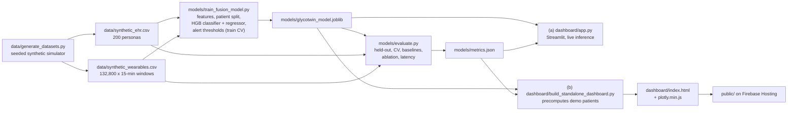
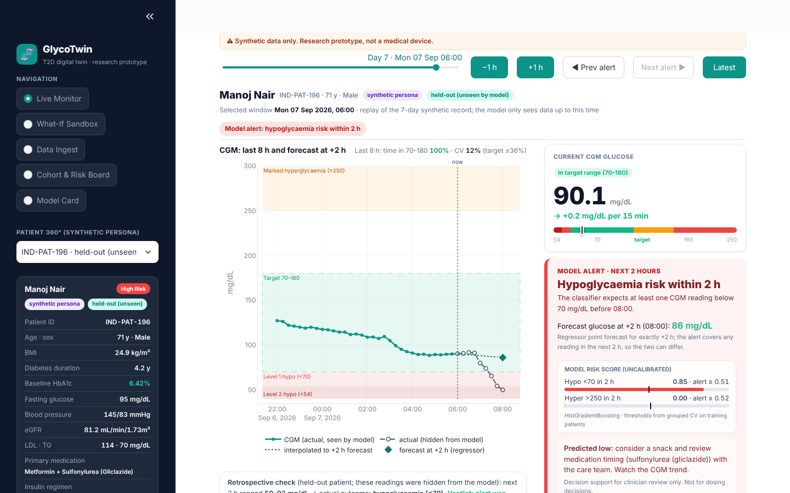
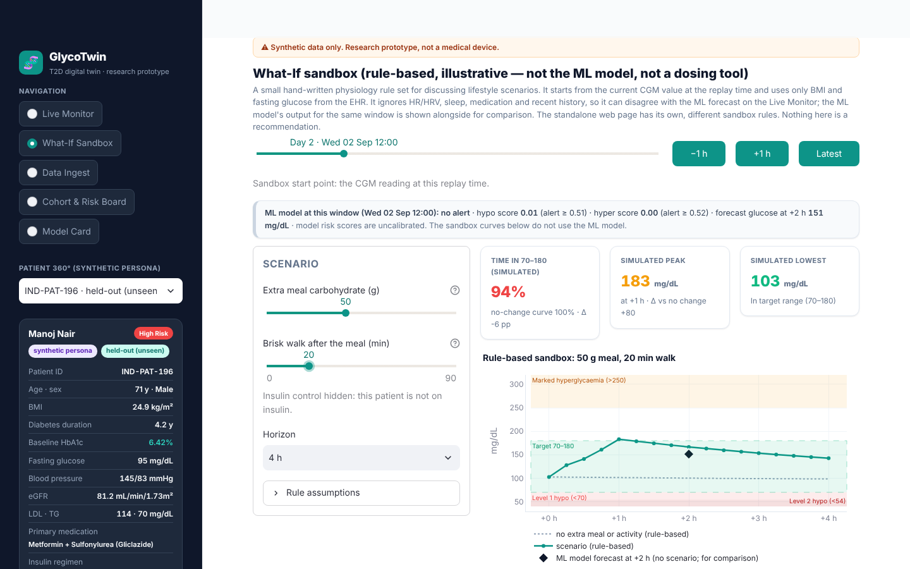
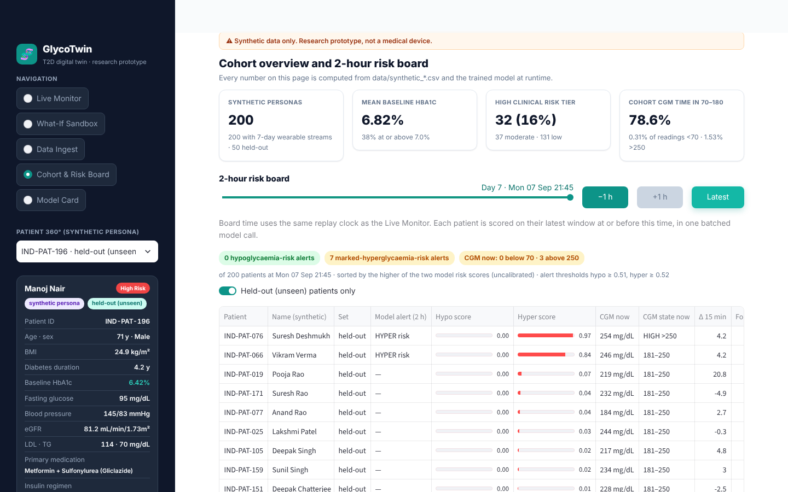
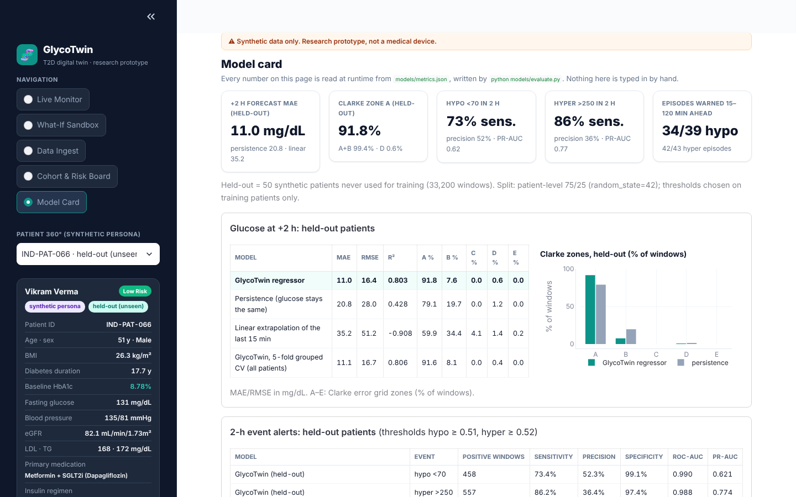
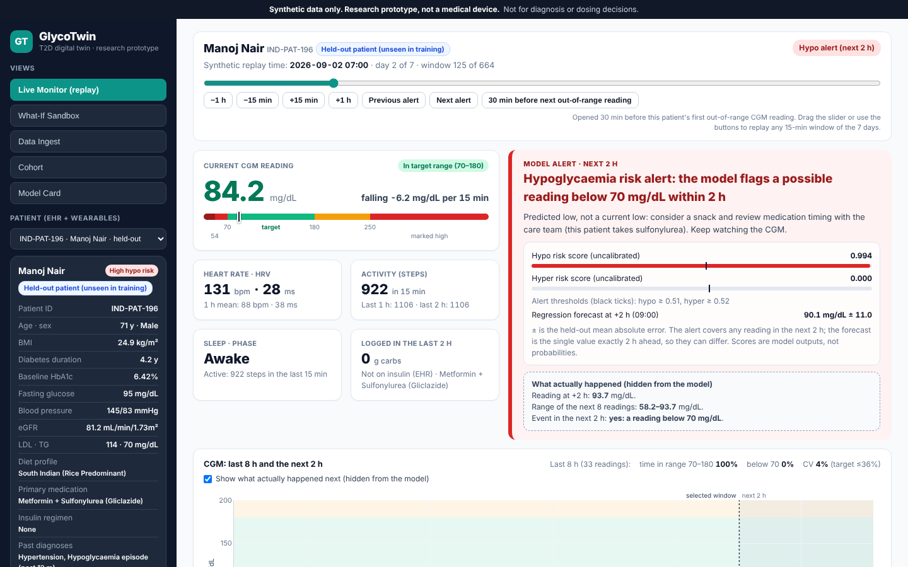
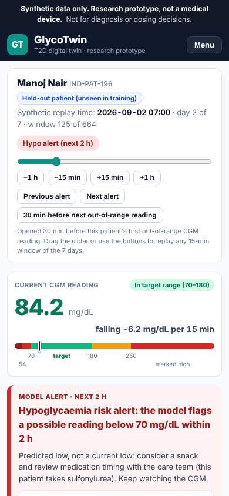

# GlycoTwin: a multimodal digital twin for Type 2 diabetes

**Forecasting hypoglycaemia (<70 mg/dL) and marked hyperglycaemia (>250 mg/dL) 2 hours ahead by fusing a synthetic EHR with synthetic CGM and wearable streams**

Happiest Health Digital Twin Challenge 2026 (Reimagining and Reforming Healthcare in India Summit, Bengaluru). Phase 1: prototype and code submission.

> **Synthetic data only. Research prototype, not a medical device. Not for diagnosis or dosing decisions.**
> Every performance number in this README is copied from [`models/metrics.json`](models/metrics.json), which `python models/evaluate.py` writes.

- Hosted standalone page: [https://glycotwin-app.web.app](https://glycotwin-app.web.app) (a static replay; its predictions are computed at build time, see [Architecture](#7-architecture-diagram-pdf-and-pptx)). The same page is in this repository as [`dashboard/index.html`](dashboard/index.html) and opens offline in any browser.
- Submission folder identifier: Classy Leopards_Goa Institute of Management

> **Repository name.** The brief asks for the folder name "Team Name_College Name". GitHub does not allow spaces in repository names, so before submitting, rename this repository to `Classy-Leopards_Goa-Institute-of-Management` (Settings > General > Repository name). GitHub redirects the old URL, so existing links keep working.

## Contents

1. [Team details and college/incubator](#1-team-details-and-collegeincubator)
2. [Project title](#2-project-title)
3. [Problem statement and healthcare use case](#3-problem-statement-and-healthcare-use-case)
4. [Technical stack and AI/ML model details](#4-technical-stack-and-aiml-model-details)
5. [Video (minimum 20 minutes)](#5-video-minimum-20-minutes)
6. [Open-source license](#6-open-source-license)
7. [Architecture diagram (PDF and PPTX)](#7-architecture-diagram-pdf-and-pptx)
8. [Presentation (PDF and PPTX)](#8-presentation-pdf-and-pptx)
9. [Quick start](#9-quick-start)
10. [Screenshots](#10-screenshots)
11. [Results](#11-results)
12. [Limitations](#12-limitations)
13. [Data provenance and privacy](#13-data-provenance-and-privacy)
14. [References](#14-references)

---

## 1. Team details and college/incubator

| Field | Submission Details |
| :--- | :--- |
| **Team Name** | **Classy Leopards** |
| **College / Institute** | **Goa Institute of Management, Sanquelim, Goa** |
| **Submission Folder Name** | `Classy Leopards_Goa Institute of Management` |
| **Team Leader** | **Shivam Raj**<br>• Email: [shivam.raj2026h@gim.ac.in](mailto:shivam.raj2026h@gim.ac.in)<br>• Phone: +91-6386147295 |
| **Team Member 2** | **Shubham Kumar**<br>• Email: [shubham.kumar2026h@gim.ac.in](mailto:shubham.kumar2026h@gim.ac.in) |
| **Team Member 3** | **Shiva Kumar Bachatty**<br>• Email: [shivakumar.bachatty@gim.ac.in](mailto:shivakumar.bachatty@gim.ac.in) |
| **Team Member 4** | **Yashita Dube**<br>• Email: [yashita.dubey2026h@gim.ac.in](mailto:yashita.dubey2026h@gim.ac.in) |
| **GitHub Username** | `kumarshubhammorya` |
| **Public GitHub Repository** | [https://github.com/kumarshubhammorya/glycotwin-digital-twin](https://github.com/kumarshubhammorya/glycotwin-digital-twin) |

---

## 2. Project title

**GlycoTwin: a multimodal digital twin for Type 2 diabetes that forecasts hypoglycaemia and marked hyperglycaemia 2 hours ahead**

---

## 3. Problem statement and healthcare use case

### The problem

- **Scale.** The ICMR-INDIAB-17 national survey estimated that in 2021, **101 million people in India had diabetes** (11.4% of adults) and **136 million had prediabetes** (15.3%) [1]. The survey counts diabetes of any type found by testing, including people who had not been diagnosed, so this is not a count of diagnosed Type 2 diabetes.
- **A different phenotype.** South Asian adults develop Type 2 diabetes at lower body weight. In a large English cohort, a BMI of about 23.9 kg/m² in South Asian people carried the same diabetes incidence as a BMI of 30 in white people [5]. Diet, age, kidney function, medication and genetics (for example the TCF7L2 rs7903146 risk allele, associated with Type 2 diabetes in Indian populations [6]) all change how one person's glucose responds.
- **Acute glycaemic events between visits.**
  - *Hypoglycaemia*: the ADA defines Level 1 as glucose <70 mg/dL and Level 2 as <54 mg/dL; Level 3 is a severe event that needs another person's help [2]. In Type 2 diabetes the main drug causes are sulfonylureas and insulin, and the risk rises with age and reduced kidney function.
  - *Marked hyperglycaemia*: readings >250 mg/dL are "level 2 time above range" in the international time-in-range consensus, which recommends more than 70% of readings in 70–180 mg/dL and fewer than 4% below 70 mg/dL for most adults [3].
- **Care is episodic.** Clinic reviews happen every few months, and finger-stick checks are snapshots. CGM shows trends, but someone still has to notice a trend that is heading out of range and act before it gets there.

### What GlycoTwin does

GlycoTwin is a data-driven twin of each patient: one model that combines the patient's static record (EHR) with the live 15-minute stream (CGM, heart rate, HRV, steps, sleep stage, logged carbohydrates and insulin), and answers two questions every 15 minutes. The twin is learned from data; it is not a mechanistic simulation of the patient's physiology.

1. **Will any CGM reading in the next 2 hours be <70 mg/dL (hypoglycaemia) or >250 mg/dL (marked hyperglycaemia)?** The classifier gives a risk score per event. An alert is raised when the score crosses a threshold chosen on training patients only.
2. **What will the glucose be exactly 2 hours from now?** The regressor gives a point forecast in mg/dL.

### Healthcare use case: how a doctor uses the twin

A diabetologist or diabetes educator looks after a panel of people with Type 2 diabetes who wear a CGM and a fitness band.

- **Cohort and risk board**: all patients ranked by the model's current 2-hour risk scores, so the few who need attention now are at the top.
- **Live monitor (patient 360°)**: one patient's EHR card; charts of the last 8 hours of CGM and of the model's two risk scores; the current heart rate, HRV, steps (last 15 min, 1 h and 2 h), sleep stage and logged carbohydrates/insulin; the 2-hour forecast and the alert. For held-out patients the readings that actually followed (hidden from the model) can be shown for comparison. For a predicted low the text says "consider a snack / review medication timing with the care team". Rescue-carbohydrate text (15 g fast-acting carbohydrate, recheck in 15 minutes [2]) appears only when the CGM is below 70 mg/dL now.
- **What-if sandbox**: a small rule-based simulator for counselling conversations ("what if this meal is larger, or followed by a walk?"). It uses hand-set rules, does not re-run the ML model and is not a dosing tool. The two dashboards use different rule sets (see [Limitations](#12-limitations)), so the same scenario can give different curves on each. A model-based what-if, which would re-score the current window with edited carbohydrate and step features (both are model inputs), is the next step.
- **Model card**: every performance number and limitation, read from `models/metrics.json`.

The intended outcome is earlier, targeted outreach (a phone call, a medication review) before an out-of-range episode, with the clinician deciding what to do. Whether this reduces real episodes would have to be measured in a prospective pilot on real patients; this prototype does not show that.

---

## 4. Technical stack and AI/ML model details

### Data streams (both synthetic, from [`data/generate_datasets.py`](data/generate_datasets.py))

| Stream | Content | Size |
| :--- | :--- | :--- |
| Static EHR (`data/synthetic_ehr.csv`) | Demographics (age, gender, diet pattern), labs (baseline HbA1c, fasting glucose, blood pressure, eGFR, LDL, triglycerides), medication (metformin, DPP-4 inhibitor, SGLT2 inhibitor, sulfonylureas, basal-bolus insulin), clinical risk tier, past diagnoses (hypertension, dyslipidaemia, neuropathy, retinopathy, NAFLD, prior hypoglycaemia), prior hypoglycaemia episodes in 12 months, family history of T2D, TCF7L2 rs7903146 risk-allele count (0/1/2) | 200 personas |
| Dynamic wearables (`data/synthetic_wearables.csv`) | Every 15 minutes for 7 days: CGM glucose, heart rate, HRV, steps, sleep stage (Awake/Light/Deep/REM), meal carbohydrates, insulin units, plus the two labels | 200 patients × 664 labelled windows = 132,800 windows |

Cohort facts (computed from the CSVs): baseline HbA1c 5.70–9.69% (mean 6.82%; 75 of 200 at or above 7.0%); clinical risk tier Low 131 / Moderate 37 / High 32 (High or Moderate = on a sulfonylurea or insulin, High if also older than 58); 66 on a sulfonylurea, 3 on basal-bolus insulin; eGFR 61–102 mL/min/1.73 m². CGM readings: 409 below 70 mg/dL (35 of them below 54 mg/dL) in 37 of the 200 patients.

The simulator couples the two streams on purpose: missed or extra insulin boluses, sulfonylurea doses taken even when breakfast is skipped (which produces lows), low glucose raises heart rate and lowers HRV, a short night's sleep raises next-day insulin resistance, TCF7L2 risk alleles and higher HbA1c raise post-meal excursions, and eGFR below 60 slows insulin clearance (no persona in the shipped cohort has eGFR below 60, so that pathway is present in the code but not exercised). Meal, walk and sleep times vary from day to day. All parameters are illustrative and not calibrated to any dataset. A code review found three quirks in how some of these couplings are applied; they are listed under [Limitations](#12-limitations).

### Labels

- `adverse_event_2h`: 0 = every reading in the next 2 h stays within 70–250 mg/dL; 1 = any reading <70 mg/dL in the next 2 h; 2 = any reading >250 mg/dL in the next 2 h (hypoglycaemia takes priority). Counts: 128,086 / 1,012 / 3,702.
- `future_glucose_2h`: the CGM reading exactly 2 h (8 windows) ahead.

### Features: 34 = 18 wearable + 16 EHR ([`models/train_fusion_model.py`](models/train_fusion_model.py))

| Group | Features (all computed from the current and past windows only) |
| :--- | :--- |
| CGM (5) | current glucose; change over the last 15 and 30 min; 1 h rolling mean and SD |
| Heart (4) | heart rate, 1 h mean heart rate, HRV, 1 h mean HRV |
| Activity (3) | steps in the last 15 min, 1 h and 2 h |
| Meals and insulin (4) | carbohydrates now and summed over 2 h; insulin units now and summed over 2 h |
| Context (2) | hour of day, sleep stage |
| EHR (16) | age, gender, BMI, diabetes duration, baseline HbA1c, fasting glucose, systolic and diastolic BP, eGFR, diet pattern, primary medication, insulin regimen, clinical risk tier, prior hypoglycaemia episodes (12 m), family history of T2D, TCF7L2 risk alleles |

LDL, triglycerides and the past-diagnosis list are shown on the patient card but are not model inputs. The EHR is joined onto every 15-minute window of the same patient (patient-level fusion). The 7 categorical features are encoded with fixed category lists (`encode_features`) that training, evaluation, tests and both dashboards share.

### Models

- **Event classifier**: scikit-learn `HistGradientBoostingClassifier`, 3 classes, `class_weight="balanced"` (inverse class-frequency weighting, because events are rare), native categorical splits, up to 150 boosting iterations, learning rate 0.08, max depth 6, `random_state=42`. scikit-learn's automatic early stopping (on an internal 10% validation split) stopped it at 83 iterations.
- **2-hour glucose regressor**: `HistGradientBoostingRegressor` with the same settings (150 iterations).
- **Alert rule**: hypoglycaemia alert if P(hypo) ≥ 0.51; otherwise marked-hyperglycaemia alert if P(hyper) ≥ 0.52. Both thresholds maximise the F2 score (recall weighted above precision) on out-of-fold predictions from 5-fold patient-grouped cross-validation over the **150 training patients only**.
- **Split**: by patient, 150 training / 50 held-out patients (`random_state=42`); no patient is in both. All held-out numbers below are on the 50 unseen patients (33,200 windows).
- **The scores are not calibrated probabilities.** Balanced class weights push minority-class scores up on purpose; the dashboards label them "risk score (uncalibrated)".
- **Latency**: about 15 ms for one window through both models (median 14.6 ms, p95 21.7 ms) and about 8 µs per window when scored in a batch, CPU only, measured by `evaluate.py`. The bundle (`models/glycotwin_model.joblib`) is about 0.6 MB.

Why gradient-boosted trees: the data is tabular and mixed (numbers plus categories), events are rare, the models train in under a minute on a CPU, inference is fast, and scikit-learn's implementation is deterministic with a fixed seed.

### Software stack

| Layer | Tools |
| :--- | :--- |
| Language | Python 3.11+ (tested on 3.13) |
| Data and ML | numpy 2.5, pandas 3.0, scikit-learn 1.9, joblib 1.6 (pinned in [`requirements.txt`](requirements.txt)) |
| Data generator | Python standard library only (`random`, `math`, `csv`, `datetime`), seeded |
| Doctor dashboard | Streamlit 1.66 + Plotly 7.1 ([`dashboard/app.py`](dashboard/app.py)): runs the shipped model live on each selected window |
| Standalone page | One static HTML page plus a local `plotly.min.js` ([`dashboard/build_standalone_dashboard.py`](dashboard/build_standalone_dashboard.py)): replays model outputs precomputed in Python for 5 held-out demo patients and 1 insulin-treated training patient; no model runs in the browser |
| Hosting | Firebase Hosting serves `public/` at [glycotwin-app.web.app](https://glycotwin-app.web.app) |
| Deck tooling | python-pptx and pypdf ([`requirements-dev.txt`](requirements-dev.txt)), LibreOffice for PDF export |

---

## 5. Video (minimum 20 minutes)

**VIDEO LINK: paste the unlisted YouTube URL here before submitting**

The brief requires a video of **at least 20 minutes** that explains and demonstrates the prototype (a PPT recording or an unlisted YouTube video). Before submitting: upload it as *Unlisted*, check the uploaded duration is over 20 minutes, open the link in a logged-out browser to confirm it plays, and paste it on the line above.

Script and demo plan: [`docs/VIDEO_SCRIPT_20MIN.md`](docs/VIDEO_SCRIPT_20MIN.md) · **[Download Script as PDF (8 pages)](docs/GlycoTwin_Video_Script_20Min.pdf)**.

---

## 6. Open-source license

Released under the **MIT License**; see [`LICENSE`](LICENSE).

```text
Copyright (c) 2026 Team Classy Leopards (Shivam Raj, Shubham Kumar, Shiva Kumar Bachatty, Yashita Dube), Goa Institute of Management
```

You may use, copy, modify, merge, publish, distribute, sublicense and sell copies of the software, provided the copyright notice and permission notice are included. The software is provided "as is", without warranty of any kind. All data in this repository is synthetic and is covered by the same license.

---

## 7. Architecture diagram (PDF and PPTX)

- PDF: [`docs/GlycoTwin_Architecture_Diagram.pdf`](docs/GlycoTwin_Architecture_Diagram.pdf)
- Editable PowerPoint: [`docs/GlycoTwin_Architecture_Diagram.pptx`](docs/GlycoTwin_Architecture_Diagram.pptx)
- Written walkthrough: [`docs/ARCHITECTURE.md`](docs/ARCHITECTURE.md)



Two serving paths: **(a)** the Streamlit app loads the bundle and scores whichever window the doctor selects; **(b)** the builder scores the demo patients in Python at build time and writes a static page, which is copied to `public/` and deployed to Firebase. Both read their performance numbers from `models/metrics.json`.

---

## 8. Presentation (PDF and PPTX)

- PDF: [`docs/GlycoTwin_Summit_Presentation.pdf`](docs/GlycoTwin_Summit_Presentation.pdf)
- Editable PowerPoint: [`docs/GlycoTwin_Summit_Presentation.pptx`](docs/GlycoTwin_Summit_Presentation.pptx)
- Plain-language guide for non-technical readers: [`docs/GLYCOTWIN_EXPLAINED.md`](docs/GLYCOTWIN_EXPLAINED.md)

The deck covers the problem, the two data streams and how they are fused, the model, held-out results against baselines, the dashboards, limitations and next steps. Its numbers come from `models/metrics.json`, as in this README.

---

## 9. Quick start

Requires Python 3.11 or newer. Run every command from the repository root.

```bash
git clone https://github.com/kumarshubhammorya/glycotwin-digital-twin.git
cd glycotwin-digital-twin
python -m venv .venv
source .venv/bin/activate            # Windows: .venv\Scripts\activate
pip install -r requirements.txt

# 1. (optional) Regenerate the synthetic data. Deterministic: reproduces the shipped CSVs byte for byte (about 2 s).
python data/generate_datasets.py

# 2. (optional) Retrain. Overwrites models/glycotwin_model.joblib (about 1 min on a laptop CPU).
python models/train_fusion_model.py

# 3. Evaluate. Prints the headline numbers and writes models/metrics.json
#    (held-out set, 5-fold grouped CV, baselines, ablations, latency; about 5 min on 4 CPU cores).
python models/evaluate.py

# 4. Prediction checks. Read-only; prints PASS/FAIL per check and exits non-zero on any failure.
python models/test_predictions.py

# 5. Doctor dashboard (Streamlit), opens on http://localhost:8501
streamlit run dashboard/app.py       # or: python run_dashboard.py

# 6. Build the standalone page (static HTML; what Firebase hosts)
python dashboard/build_standalone_dashboard.py
cp dashboard/index.html dashboard/plotly.min.js public/
#    open dashboard/index.html in a browser; to publish: firebase deploy --only hosting
```

Steps 1 and 2 are optional because the CSVs and the trained bundle are committed. Running steps 1 to 3 from scratch reproduces the shipped CSVs, bundle metrics and `metrics.json` exactly, apart from the latency figures (we checked this on a clean copy). If you retrain, run step 3 again so `metrics.json` matches the new bundle (`evaluate.py` stops if the bundle and the data do not match). `models/test_predictions.py` checks that (a) the bundle's stored metrics and `metrics.json` match a fresh re-score of the held-out patients, (b) IND-PAT-196 gets a hypoglycaemia alert in the 2 h before its first reading below 70 mg/dL, (c) IND-PAT-077 gets a hyperglycaemia alert before its first reading above 250 mg/dL, (d) stable windows of IND-PAT-046 get no alert, and (e) every category in the CSVs encodes to a valid code.

Demo patients (all held out, i.e. unseen in training): **IND-PAT-196** (71 y, gliclazide, High Risk; 55 readings below 70 mg/dL, lowest 41.4), **IND-PAT-080** (46 y, gliclazide; 60 readings below 70), **IND-PAT-077** (70 y, metformin; 55 readings above 250), **IND-PAT-066** (51 y, SGLT2 inhibitor; 51 readings above 250) and **IND-PAT-046** (62 y, stable, no events). The insulin-treated patient on the standalone page is a training patient and is labelled as such.

### Repository layout

```text
data/
  generate_datasets.py           seeded simulator for both streams
  synthetic_ehr.csv              200 synthetic EHR records
  synthetic_wearables.csv        132,800 labelled 15-min windows
models/
  train_fusion_model.py          features, encoding, training, alert thresholds
  evaluate.py                    full evaluation -> metrics.json
  test_predictions.py            read-only PASS/FAIL checks
  glycotwin_model.joblib         trained classifier + regressor + metadata
  metrics.json                   the only source of performance numbers
dashboard/
  app.py                         Streamlit doctor dashboard (live inference)
  build_standalone_dashboard.py  builds the static page
  index.html, plotly.min.js      the built static page
public/                          copy of the static page deployed to Firebase
docs/                            architecture diagram, deck, video script, guides, screenshots
run_dashboard.py                 launches the Streamlit app from any directory
generate_summit_docs.py          deck and diagram generator (needs requirements-dev.txt)
```

---

## 10. Screenshots

Streamlit doctor dashboard, Live Monitor on held-out patient IND-PAT-196: the model raises a hypoglycaemia alert while the CGM is still in range; the readings that followed (hidden from the model) are drawn for comparison.



What-if sandbox in Streamlit (rule-based, separate from the ML model; the standalone page uses a different rule set, see [Limitations](#12-limitations)):



Cohort overview and 2-hour risk board, with patients ranked by model risk score:



Model card, with every number read from `models/metrics.json`:



Standalone page (the Firebase build), desktop and phone:





---

## 11. Results

All numbers come from [`models/metrics.json`](models/metrics.json) (`python models/evaluate.py`). Held-out = the 50 patients never used for training or for choosing thresholds (33,200 windows). The data is synthetic, so these numbers describe how well the model learns this simulator, not how it would perform on real patients.

### 2-hour glucose forecast (held-out patients)

| Metric | GlycoTwin regressor | Persistence baseline ("glucose stays the same") | Linear extrapolation (last 15-min change × 8) |
| :--- | ---: | ---: | ---: |
| MAE (mg/dL) | **11.0** | 20.8 | 35.2 |
| RMSE (mg/dL) | 16.4 | 28.0 | 51.2 |
| R² | 0.803 | 0.428 | −0.908 |
| Clarke zone A | 91.8% | 79.1% | 59.9% |
| Clarke zone B | 7.6% | 19.7% | 34.4% |
| Clarke zones C / D / E | 0% / 0.6% / 0% | 0% / 1.2% / 0% | 4.1% / 1.4% / 0.2% |

Computed by comparing each window's prediction with the CGM reading exactly 2 h later. Clarke Error Grid zones follow Clarke et al. 1987 [4]; 99.4% of forecasts fall in zones A+B (91.81% + 7.58%).

### 2-hour event alerts, per 15-minute window (held-out patients)

| Metric | Hypoglycaemia (<70 mg/dL in next 2 h) | Marked hyperglycaemia (>250 mg/dL in next 2 h) |
| :--- | ---: | ---: |
| Positive windows (prevalence) | 458 (1.4%) | 557 (1.7%) |
| Sensitivity (recall) | **73.4%** (336 of 458) | **86.2%** (480 of 557) |
| Precision (alerts that were followed by the event) | 52.3% (336 of 643) | 36.4% (480 of 1,318) |
| Specificity | 99.1% | 97.4% |
| ROC-AUC | 0.990 | 0.988 |
| PR-AUC (average precision) | 0.621 | 0.774 |
| Only windows where CGM is in 70–250 now: sensitivity / precision / PR-AUC | 63.2% / 39.3% / 0.431 | 77.9% / 24.0% / 0.521 |
| Rule baseline (CGM <90 and falling / >200 and rising): sensitivity / precision | 42.8% / 33.9% | 40.8% / 15.6% |

Computed from the alert rule above (thresholds 0.51 / 0.52) against `adverse_event_2h`. ROC-AUC and PR-AUC use the raw risk scores. The "CGM in 70–250 now" row drops windows where the patient is already out of range, which is the harder early-warning case.

### Episode-level early warning (held-out patients)

| Metric | Hypoglycaemia | Marked hyperglycaemia |
| :--- | ---: | ---: |
| Episodes (runs of readings out of range, with at least 2 h of history before them) | 39 | 43 |
| Episodes warned 15–120 min before the first out-of-range reading | **34 (87%)** | **42 (98%)** |
| Median lead time of the first warning | 120 min (the most the 2-h window allows) | 120 min |
| Alarms (alert onsets) per patient-day | 0.36 | 0.58 |
| Fraction of alarms not followed by that event within 2 h | **69%** | **88%** |

Most alarms are not followed by an event. In clinical use this means alarm fatigue, and it is the main weakness of the current thresholds, which favour sensitivity (F2).

### 5-fold patient-grouped cross-validation (all 200 patients, 132,800 windows)

| Metric | Value |
| :--- | ---: |
| Forecast MAE / R² / Clarke A | 11.08 mg/dL / 0.806 / 91.6% (persistence MAE 20.95) |
| Hypoglycaemia: sensitivity / precision / ROC-AUC / PR-AUC | 75.5% / 37.1% / 0.987 / 0.548 |
| Hyperglycaemia: sensitivity / precision / ROC-AUC / PR-AUC | 82.5% / 51.8% / 0.987 / 0.820 |

Each fold trains fresh models on 4/5 of the patients and scores the rest, so every patient is scored once by a model that never saw them. The shipped alert thresholds are reused.

Cross-validation and the held-out split give a similar forecast error (MAE 11.08 vs 11.0 mg/dL) and similar sensitivity, but **precision differs**: hypo 37.1% in CV vs 52.3% held-out, hyper 51.8% vs 36.4%. Part of the reason is that event prevalence differs between the two sets of patients (hypo windows are 0.76% of all 200 patients' windows vs 1.38% of the held-out windows; hyper 2.79% vs 1.68%), and precision rises with prevalence. With 50 held-out patients, a single split's precision is not a stable estimate.

### Does fusing the EHR help? Ablation (5-fold grouped CV) and EHR-swap test

| Feature set | Features | Forecast MAE (mg/dL) | Hypo PR-AUC | Hyper PR-AUC |
| :--- | ---: | ---: | ---: | ---: |
| All: EHR + wearables (shipped) | 34 | 11.08 | 0.548 | 0.820 |
| Wearables only | 18 | 11.45 | 0.530 | 0.855 |
| EHR only + hour of day | 17 | 15.91 | 0.206 | 0.266 |
| Without CGM features | 29 | 14.55 | 0.426 | 0.452 |
| Without HR, HRV and sleep stage | 29 | 11.07 | 0.550 | 0.823 |
| Without prior hypos, family history, TCF7L2 | 31 | 11.10 | 0.555 | 0.825 |
| Without hour of day | 33 | 13.86 | 0.509 | 0.760 |

**EHR-swap test** (held-out patients scored with another held-out patient's EHR): forecast MAE rises from 11.0 to 16.13 mg/dL, hypo PR-AUC falls from 0.621 to 0.435 and hyper PR-AUC from 0.774 to 0.646.

What this shows, honestly:

- **The model uses the EHR.** Giving a patient the wrong record makes every metric worse.
- **Fusion helps the forecast and hypoglycaemia detection a little**: MAE 11.45 → 11.08 mg/dL and hypo PR-AUC 0.530 → 0.548 compared with wearables only.
- **Hyperglycaemia detection is driven by the wearables**; the wearables-only model ranks hyper risk slightly better (PR-AUC 0.855 vs 0.820).
- **CGM is the most important stream**, and **hour of day matters** because daily routines are fairly regular in the simulator.
- **HR, HRV and sleep add little independent signal**, and the history and genetics fields add no measurable signal, in this synthetic data.

### Speed

About 15 ms per single window for both models (median 14.6 ms, p95 21.7 ms) and about 8 µs per window in a batch; CPU only, on the machine that ran `evaluate.py`.

---

## 12. Limitations

- **Synthetic data only.** Both streams come from our own simulator. The model learns the simulator's rules, so the high ROC-AUC values partly reflect a simulator that is much simpler than real physiology. None of these results transfer to real patients.
- **Illustrative, uncalibrated simulator.** Parameters are hand-set. Population ranges are loosely informed by published Indian literature, but nothing is calibrated to any dataset (not to ICMR-INDIAB, NFHS-5 or any CGM study). The cohort is mostly well controlled (mean HbA1c 6.82%, maximum 9.69%).
- **Uncalibrated scores.** Classifier outputs are risk scores from a class-weighted model, not probabilities of an event; they are only meaningful relative to the alert thresholds.
- **False alarms.** About 0.36 hypoglycaemia and 0.58 hyperglycaemia alarms per patient-day, and 69% / 88% of them are not followed by an event within 2 h. Window-level precision is 52.3% (hypo) and 36.4% (hyper).
- **Some of the window-level performance comes from patients already out of range.** On windows where CGM is currently 70–250 mg/dL, sensitivity is 63.2% (hypo) and 77.9% (hyper).
- **HR, HRV and sleep add little independent signal** here (removing them leaves MAE at 11.07), even though the simulator links them to glucose. The history and genetic fields add no measurable signal either.
- **Schedule regularity.** Meals, walks and sleep follow daily routines with up to about an hour of jitter, so hour of day is a strong feature (removing it raises MAE from 11.08 to 13.86). Real routines are less regular.
- **No insulin-treated patient in the held-out set.** Only 3 of 200 personas use insulin (all basal-bolus), and all 3 are training patients, so there is no held-out evidence for insulin users. No persona has eGFR below 60, so the kidney pathway is untested. Lows are rare: 37 of 200 patients have any reading below 70 mg/dL and only 35 readings are below 54 mg/dL, too few to evaluate Level 2 hypoglycaemia separately.
- **Single 2-hour point forecast.** The regressor predicts one value, 2 h ahead. The Streamlit chart draws a dotted line from "now" to that point; the line is interpolation, not a forecast trajectory. The standalone page shows only the +2 h point, with error bars of ± the held-out MAE.
- **The what-if sandboxes are rule-based, not the ML model, and the two dashboards use different rules.** Both are for discussion, not dosing, and neither rule set is fitted to data or validated.
  - *Streamlit* (`dashboard/app.py`): starts from the current CGM. Its "no change" curve relaxes 5% towards the patient's fasting glucose every 15 minutes. A meal adds 1.8 mg/dL per gram × BMI/22, and a walk removes 0.7 mg/dL per minute. Its only EHR inputs are BMI and fasting glucose, plus an insulin slider for insulin users.
  - *Standalone page* (`dashboard/build_standalone_dashboard.py`, `SANDBOX_RULES`): its baseline is a straight line from the current CGM to the ML model's precomputed +2 h forecast. A meal adds 1.2 mg/dL per gram, with a peak at 60 minutes, and a walk removes 0.8 mg/dL per minute, × 1.5 for sulfonylurea or insulin users. It does not use BMI or fasting glucose.
  - Because the rules differ, the same scenario for the same patient and window gives noticeably different peaks and lows on the two pages.
  - A model-based what-if is future work: re-score the current window with edited carbohydrate and step features, which are model inputs.
- **Known simulator quirks.** A code review of `data/generate_datasets.py` found three. We left them unchanged so that the shipped data, model and `metrics.json` stay reproducible.
  - When an insulin user's evening basal dose falls in the same 15-minute slot as a dinner over 30 g, the meal bolus is not given. This adds unintended missed boluses on top of the designed 10% rate; it affects only the 3 insulin users, who are all training patients.
  - The short-night flag shortens that day's *morning* wake and delays that day's *evening* bedtime. The next-day insulin resistance (×1.15) and HRV drop follow the late bedtime correctly. For the early wake, they land one day late.
  - The eGFR-below-60 kidney pathway and the basal-only insulin regimen ("Basal Insulin (Glargine 10-20U)") exist in the code but never occur in the shipped cohort.
- **Ingest.** The Data Ingest view validates a generic CGM CSV (and the GlycoTwin schema). Native parsers for vendor exports (Dexcom, LibreView, Apple Health, Health Connect) are not built.
- **Evaluation design.** One random patient split plus 5-fold grouped CV; the CV reuses the thresholds chosen on the 150 training patients. Forecast error and sensitivity are close between the two, but alert precision differs by about 15 percentage points (in opposite directions for hypo and hyper), so the held-out precision figures are not stable estimates. Latency was measured on one CPU machine.
- **Not a medical device.** No clinical validation has been done. Clinical use would need prospective validation on real CGM and EHR data, clinician-in-the-loop evaluation and regulatory review (software as a medical device under India's Medical Devices Rules, 2017).

---

## 13. Data provenance and privacy

- **All data is synthetic.** `data/generate_datasets.py` creates both CSVs from fixed random seeds using only the Python standard library; running it reproduces the shipped files byte for byte. No real patient record, device export or open dataset is used.
- **No personal health data.** This prototype uses only synthetic data, so no personal health data is processed (designed with DPDP Act 2023 principles in mind). The persona names are random combinations of common Indian first and last names; any match with a real person is coincidental. No data is sent to third parties: the standalone page reads uploaded files in the browser only, and the Streamlit app runs wherever you start it.
- **Why a custom simulator, when the brief allows Synthea, MIMIC-IV or open wearable data?**
  - The task needs both streams for the *same* person, aligned in time, with a label for every 15-minute window. Synthea produces EHRs but no 15-minute CGM, heart rate, HRV or sleep streams, and its population modules are built on US statistics.
  - MIMIC-IV is ICU and hospital data rather than outpatient Type 2 diabetes care, and its credentialed-access data use agreement does not allow redistribution, so it could not be shipped in a public repository.
  - Open CGM datasets do not come with a linked EHR containing genetic markers, and we did not find one from an Indian population.
  - A simulator lets us build in the mechanisms we want the twin to learn (sulfonylurea lows on skipped meals, missed boluses, kidney function, genotype) and know the ground truth for every window.
  - The cost is realism, which is why every result above is labelled synthetic.
- **Future work.** Generate the EHR side with Synthea using an India-adapted module and join it to simulated or real CGM streams. Validate the model on open Type 2 diabetes CGM datasets (for example ShanghaiT2DM, or CGMacros on PhysioNet), after checking each licence. Then run a prospective, consented pilot with an Indian diabetes clinic.

---

## 14. References

1. Anjana RM, Unnikrishnan R, Deepa M, et al. Metabolic non-communicable disease health report of India: the ICMR-INDIAB national cross-sectional study (ICMR-INDIAB-17). *Lancet Diabetes Endocrinol.* 2023;11(7):474–489. doi:10.1016/S2213-8587(23)00119-5
2. American Diabetes Association Professional Practice Committee. 6. Glycemic goals and hypoglycemia: Standards of Care in Diabetes—2025. *Diabetes Care.* 2025;48(Suppl 1):S128–S145. doi:10.2337/dc25-S006
3. Battelino T, Danne T, Bergenstal RM, et al. Clinical targets for continuous glucose monitoring data interpretation: recommendations from the International Consensus on Time in Range. *Diabetes Care.* 2019;42(8):1593–1603. doi:10.2337/dci19-0028
4. Clarke WL, Cox D, Gonder-Frederick LA, Carter W, Pohl SL. Evaluating clinical accuracy of systems for self-monitoring of blood glucose. *Diabetes Care.* 1987;10(5):622–628. doi:10.2337/diacare.10.5.622
5. Caleyachetty R, Barber TM, Mohammed NI, et al. Ethnicity-specific BMI cutoffs for obesity based on type 2 diabetes risk in England: a population-based cohort study. *Lancet Diabetes Endocrinol.* 2021;9(7):419–426. doi:10.1016/S2213-8587(21)00088-7
6. Chandak GR, Janipalli CS, Bhaskar S, et al. Common variants in the TCF7L2 gene are strongly associated with type 2 diabetes mellitus in the Indian population. *Diabetologia.* 2007;50(1):63–67. doi:10.1007/s00125-006-0502-2
7. Pedregosa F, Varoquaux G, Gramfort A, et al. Scikit-learn: machine learning in Python. *J Mach Learn Res.* 2011;12:2825–2830.
8. The Digital Personal Data Protection Act, 2023 (No. 22 of 2023), Government of India.
