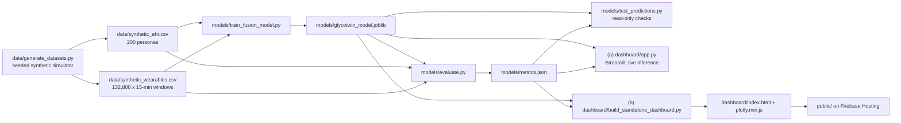

# GlycoTwin architecture

This document describes what the code in this repository actually does, file by file. The slide versions are [`GlycoTwin_Architecture_Diagram.pdf`](GlycoTwin_Architecture_Diagram.pdf) and [`GlycoTwin_Architecture_Diagram.pptx`](GlycoTwin_Architecture_Diagram.pptx).

> Synthetic data only. Research prototype, not a medical device. Not for diagnosis or dosing decisions.
> Every performance number here comes from [`../models/metrics.json`](../models/metrics.json), which `models/evaluate.py` writes.

## 1. Pipeline at a glance



| Stage | File | Reads | Writes |
| :--- | :--- | :--- | :--- |
| 1. Simulate | `data/generate_datasets.py` | nothing (fixed seeds) | `data/synthetic_ehr.csv`, `data/synthetic_wearables.csv` |
| 2. Train | `models/train_fusion_model.py` | both CSVs | `models/glycotwin_model.joblib` |
| 3. Evaluate | `models/evaluate.py` | both CSVs, bundle | `models/metrics.json` |
| 4. Check | `models/test_predictions.py` | both CSVs, bundle, metrics | nothing |
| 5a. Serve live | `dashboard/app.py` (Streamlit) | both CSVs, bundle, metrics | nothing |
| 5b. Serve static | `dashboard/build_standalone_dashboard.py` | both CSVs, bundle, metrics | `dashboard/index.html`, `dashboard/plotly.min.js` (copied to `public/` for Firebase) |

Every stage runs from the repository root on a CPU. Stages 1 to 3 are deterministic: re-running them reproduces the shipped files, apart from the latency figures in `metrics.json`.

## 2. Data simulation (`data/generate_datasets.py`)

Pure Python standard library, seeded (`random.seed(42)`, plus separate seeded streams for history, genetics and each patient's wearables).

**Static EHR, 200 personas.** Age, gender, diet pattern (North Indian high-carb, South Indian rice-predominant, vegetarian balanced, non-vegetarian high-protein), BMI, diabetes duration, baseline HbA1c, fasting glucose, blood pressure, eGFR, LDL, triglycerides, primary medication, insulin regimen, clinical risk tier, past diagnoses, prior hypoglycaemia episodes in the last 12 months, family history of T2D, and TCF7L2 rs7903146 risk-allele count (drawn from Hardy-Weinberg proportions). Medication follows HbA1c and duration. The risk tier is rule-based: a sulfonylurea or insulin user is High Risk if older than 58 and Moderate Risk otherwise; everyone else is Low Risk. In the shipped cohort: HbA1c 5.70–9.69%, tiers Low 131 / Moderate 37 / High 32, 66 sulfonylurea users, 3 basal-bolus insulin users, eGFR 61–102.

**Wearables, 7 days × 96 windows of 15 minutes per persona.** A simple compartment model updates glucose every 15 minutes:

- carbohydrate absorption from a gut pool, scaled by BMI, HbA1c and TCF7L2 risk alleles;
- insulin or sulfonylurea action from a drug pool. Clearance is slower when eGFR is below 60, but no shipped persona is below 60, so that branch is not exercised;
- glucose uptake from steps (walks raise heart rate and lower HRV);
- reversion towards the persona's fasting level, hepatic counter-regulation below 70 mg/dL, a dawn rise for some personas, and noise.

Behaviour varies from day to day: meal, walk, sleep and wake times are jittered by up to about an hour, meals are sometimes skipped, about 10% of days are heavy-carbohydrate days, and about 15% of nights are short. Sleep stages are Awake, Light, Deep and REM, with more deep sleep early in the night and more REM late.

The two streams are deliberately coupled:

- bolus insulin is sometimes missed and sometimes over-dosed (see the quirks below for an unintended extra source of missed boluses);
- sulfonylureas are taken even when breakfast is skipped, which produces lows;
- glucose below 70 mg/dL raises heart rate and lowers HRV;
- a short night raises next-day insulin resistance (×1.15) and lowers daytime HRV;
- the persona's latent hypoglycaemia propensity (from medication, age and kidney function; the kidney term never fires in the shipped cohort) drives both the recorded prior-hypo history and the overnight dips.

**Labels**, computed for every window that has 2 h of future data (the last 8 windows of each record are dropped, which leaves 664 per persona and 132,800 in total):

- `adverse_event_2h` = 1 if any of the next 8 readings is <70 mg/dL, else 2 if any is >250 mg/dL, else 0 (counts 1,012 / 3,702 / 128,086);
- `future_glucose_2h` = the reading exactly 8 windows ahead.

All parameters are illustrative. Population ranges are loosely informed by published Indian literature but are not calibrated to any dataset.

**Known quirks** (found in code review; left unchanged so that the shipped CSVs, bundle and `metrics.json` stay reproducible):

- The meal bolus is an `elif` of the basal dose. When an insulin user's basal slot (21:00–22:00) coincides with a dinner over 30 g, only the basal dose is given and logged. This adds unintended missed boluses for the 3 insulin users, all of whom are training patients.
- `poor_sleep` for day *d* shortens day *d*'s morning wake and delays day *d*'s evening bedtime. The resulting resistance and HRV drop are applied on day *d*+1. That matches the late bedtime, but for the early wake it is one day late.
- eGFR never falls below 60, so `renal_slow`, the +0.20 propensity term and the "CKD stage 3" diagnosis never occur. The insulin regimens generated are "None" (197) and "Basal-Bolus" (3) only.

## 3. Features and fusion (`models/train_fusion_model.py`)

`compute_wearable_features` sorts each patient's rows by time and adds backward-looking features only (no future information):

| Feature | Definition |
| :--- | :--- |
| `glucose_velocity_15m`, `glucose_velocity_30m` | change in CGM over the last 1 and 2 windows (mg/dL) |
| `glucose_mean_1h`, `glucose_std_1h` | rolling mean and SD of the last 4 readings |
| `hr_mean_1h`, `hrv_mean_1h` | rolling mean of the last 4 readings |
| `steps_sum_1h`, `steps_sum_2h` | rolling sum of steps over 4 and 8 windows |
| `carbs_sum_2h`, `insulin_sum_2h` | rolling sum over 8 windows |
| `hour_of_day` | from the timestamp |

These are joined with the raw `glucose_cgm`, `heart_rate`, `hrv`, `steps_15m`, `meal_carbs_g`, `insulin_units` and `sleep_stage`, which gives **18 wearable features**.

`prepare_fused_dataset` joins the **16 EHR features** onto every window of the same patient: age, gender, BMI, diabetes duration, baseline HbA1c, fasting glucose, systolic and diastolic BP, eGFR, diet profile, primary medication, insulin regimen, clinical risk tier, prior hypo episodes (12 m), family history of T2D, and TCF7L2 risk alleles. That makes **34 features** in total. LDL, triglycerides and the past-diagnosis text are displayed but are not model inputs.

`encode_features` turns the 7 categorical columns into integer codes using the fixed `CATEGORY_LEVELS` lists; unknown values become missing. Training, evaluation, the tests and both dashboards all call this one function, so a category always gets the same code. The EHR CSV must be read with `keep_default_na=False` (as `load_data` does), otherwise pandas turns the insulin regimen string "None" into NaN.

## 4. Training (`models/train_fusion_model.py`)

1. **Patient-level split**: 150 training and 50 held-out patients (`train_test_split` on patient IDs, `random_state=42`).
2. **Alert thresholds**: 5-fold `GroupKFold` by patient over the 150 training patients produces out-of-fold class scores. For each event class the threshold that maximises F2 (recall weighted above precision) on a 0.05–0.95 grid is kept. This gives hypo 0.51 and hyper 0.52.
3. **Final models** fitted on all 150 training patients:
   - `HistGradientBoostingClassifier` with 3 classes, `class_weight="balanced"`, native categorical support, `max_iter=150`, `learning_rate=0.08`, `max_depth=6`, `random_state=42`. scikit-learn's default early stopping ended it at 83 iterations.
   - `HistGradientBoostingRegressor` with the same settings for `future_glucose_2h`.
4. **Alert rule** (`apply_alert_thresholds`): hypo if P(hypo) ≥ 0.51, else hyper if P(hyper) ≥ 0.52, else no alert. The class scores are **not calibrated**; balanced weights inflate minority-class scores, so they are shown as risk scores.
5. **Bundle** (`models/glycotwin_model.joblib`, about 0.6 MB) contains `classifier`, `regressor`, `feature_cols`, `cat_features`, `category_levels`, `class_names`, `alert_thresholds`, `train_patients`, `test_patients`, and `metrics` (held-out MAE 11.0, R² 0.803, alert macro-F1 0.70).

## 5. Evaluation (`models/evaluate.py` → `models/metrics.json`)

`evaluate.py` scores the shipped bundle and stops if its held-out MAE does not match the value stored in the bundle. It writes:

| Block | What is computed | Headline values |
| :--- | :--- | :--- |
| `holdout.regressor` | MAE, RMSE, R², Clarke Error Grid zones on the 50 held-out patients | MAE 11.0 mg/dL, R² 0.803, Clarke A 91.81%, B 7.58%, D 0.61% |
| `holdout.baseline_*` | persistence ("glucose stays the same") and linear extrapolation | MAE 20.77 and 35.2 |
| `holdout.classifier` | confusion matrix, sensitivity, precision, specificity, ROC-AUC, PR-AUC per event | hypo 73.4% / 52.3% / PR-AUC 0.621; hyper 86.2% / 36.4% / PR-AUC 0.774 |
| `holdout.classifier_not_already_in_event` | same, only windows with CGM in 70–250 now | hypo sensitivity 63.2%, hyper 77.9% |
| `holdout.episodes_*` | episodes warned 15–120 min ahead, alarms per patient-day, false-alarm fraction | hypo 34/39, 0.36 per day, 69% false; hyper 42/43, 0.58 per day, 88% false |
| `holdout.rule_baseline_events` | non-ML rule: CGM <90 and falling / >200 and rising | sensitivity 42.8% / 40.8% |
| `holdout.ehr_swap_test` | held-out patients scored with another patient's EHR | MAE 16.13, hypo PR-AUC 0.435 |
| `grouped_cv_5fold` | 5-fold patient-grouped CV over all 200 patients | MAE 11.08; hypo PR-AUC 0.548; hyper PR-AUC 0.82 |
| `ablation_grouped_cv_5fold` | the same CV with feature groups removed | wearables only: MAE 11.45; EHR only + hour: 15.91; without CGM: 14.55; without hour of day: 13.86; without HR/HRV/sleep: 11.07 |
| `latency` | single-window and batched inference time | about 15 ms per window; about 8 µs per window batched (CPU) |

Every number in the README, the slides, the video script and the dashboards' model cards should be read from this file.

## 6. Serving

### (a) Streamlit doctor dashboard: `dashboard/app.py`

Run with `streamlit run dashboard/app.py` or `python run_dashboard.py`. The app loads the CSVs and the bundle once, and for the selected patient and replay time builds the model input with the same helpers as training (`compute_wearable_features` → `prepare_fused_dataset` → `encode_features`). It then calls the classifier, `apply_alert_thresholds` and the regressor live. If the model cannot be loaded, the page shows an error and no forecast; it never shows the dataset's future labels as a prediction. It has five views:

| View | What it does |
| :--- | :--- |
| Live Monitor | patient 360° EHR card; chart of the last 8 h of CGM with the +2 h forecast point, joined to "now" by a dotted interpolation line (not a trajectory); chart of both risk scores over the last 8 h against their thresholds; cards with the current heart rate, HRV and 1 h mean heart rate, steps (15 min, 1 h, 2 h), sleep stage, and carbohydrates/insulin logged in the last 2 h; current CGM with trend and the model alert; for held-out patients, a retrospective check against what actually happened; a list of the week's alerts |
| What-If Sandbox | a small **rule-based** simulator (meal size, walk duration, a 2/4/6 h horizon and, for insulin users, an insulin slider) starting from the current CGM. Its "no change" curve relaxes 5% towards fasting glucose every 15 min; a meal adds 1.8 mg/dL per g × BMI/22 over the first hour; a walk removes 0.7 mg/dL per minute. Its only EHR inputs are BMI and fasting glucose. It is not the ML model, it does not re-score the model, and it gives no dosing advice |
| Data Ingest | parses an uploaded CSV or JSON and runs five checks (schema, continuity, physiological bounds, rate of change, missingness); if the file has the full GlycoTwin wearable schema, the model scores its latest window |
| Cohort & Risk Board | cohort KPIs computed from the CSVs; every patient scored at the replay time in one batched call and ranked by risk score |
| Model Card | every metric, the ablation, the EHR-swap test and the limitations, read from `metrics.json` at runtime |

### (b) Standalone page: `dashboard/build_standalone_dashboard.py` → Firebase

The builder runs the bundle in Python over the demo patients: the 5 held-out patients IND-PAT-196, 080, 077, 066 and 046, plus one insulin-treated **training** patient, tagged as such because no insulin user is in the held-out set. It embeds the risk scores, alerts and forecasts in one static HTML page and copies Plotly next to it as `plotly.min.js`, so the page works offline and needs no CDN. **No model runs in the browser.** Uploaded files in the page's ingest view are validated in the browser only.

It differs from the Streamlit app in two visible ways:

- **Live Monitor chart.** The +2 h forecast is a single marker with error bars of ± the held-out MAE, with no line from "now". The page also has a 7-day replay overview chart. As in Streamlit, only CGM and the risk scores are charted over 8 h; the wearable signals are cards with current values and 1 h / 2 h summaries.
- **What-If Sandbox.** It uses its own rules (`SANDBOX_RULES` in the builder). The baseline is a straight line from the current CGM to the precomputed ML forecast at +2 h. A meal adds 1.2 mg/dL per g with a peak at 60 min. A walk removes 0.8 mg/dL per minute, multiplied by 1.5 for sulfonylurea or insulin users, and insulin users also get an insulin slider. It does not use BMI or fasting glucose, and the horizon is fixed at 2 h.

Because these rules differ from Streamlit's, the same scenario gives different curves on the two pages. Neither rule set is fitted to data.

A model-based what-if is the planned next step. It would re-score the current window with edited `carbs_sum_2h` and `steps_sum_1h`/`steps_sum_2h` values, which are model inputs.

To publish:

```bash
python dashboard/build_standalone_dashboard.py
cp dashboard/index.html dashboard/plotly.min.js public/
firebase deploy --only hosting      # serves public/ at https://glycotwin-app.web.app
```

## 7. Checks (`models/test_predictions.py`)

A read-only script that exits non-zero on any failure. It checks that:

- (a) the bundle's stored metrics and the held-out numbers in `metrics.json` match a fresh re-score of the 50 held-out patients;
- (b) IND-PAT-196 receives a hypoglycaemia alert in the 2 h before its first reading below 70 mg/dL;
- (c) IND-PAT-077 receives a hyperglycaemia alert in the 2 h before its first reading above 250 mg/dL;
- (d) no stable window of IND-PAT-046 gets an alert;
- (e) every category in the CSVs maps to a valid code and the bundle stores the same category levels.

## 8. Toward real-world data (roadmap, not implemented)

None of the following exists in the code yet. It is how the same pipeline would connect to real systems:

- **EHR**: HL7 FHIR resources (`Patient`, `Observation` for HbA1c, eGFR and lipids, `MedicationStatement`, `Condition`) mapped onto the 16 EHR features.
- **CGM and wearables**: vendor exports or APIs (for example LibreView, Dexcom, Health Connect, HealthKit), resampled to 15-minute windows and validated with the same five ingest checks.
- **Models**: retrained and recalibrated on real data, with grouped validation by patient and by site, and prospective clinician-in-the-loop evaluation before any clinical use.

## 9. Privacy and safety

- Only synthetic data is used, so no personal health data is processed (designed with DPDP Act 2023 principles in mind). The persona names are random combinations of common names.
- Alerts are decision support for clinician review. Rescue-carbohydrate text appears only when the current CGM is below 70 mg/dL; a predicted low prompts "consider a snack / review medication timing with the care team". The software never gives insulin dose numbers as advice.
- This is a research prototype, not a medical device, and it has not been clinically validated.
