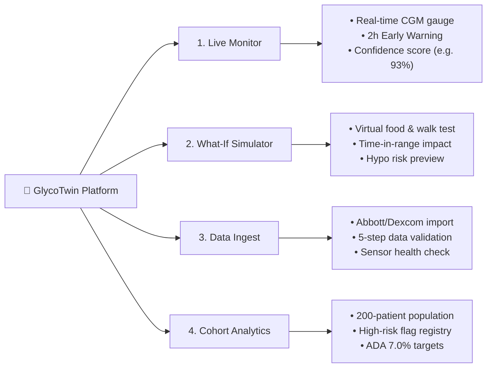
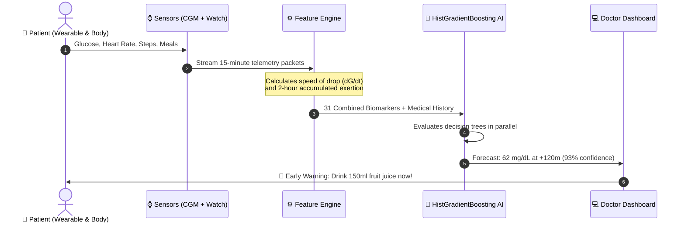

# 🧬 GlycoTwin: Plain-Language Guide & Architecture Explained

> **A non-technical, comprehensive guide to how GlycoTwin turns wearable sensor data and medical records into a 2-hour early warning system and "flight simulator" for Type 2 Diabetes.**

---

## 1. What is GlycoTwin? (The Big Picture)

Imagine driving a car down a winding road at night with the headlights turned off, and the only way you know where you are is by checking the rear-view mirror every few hours. 

For decades, that is exactly how people have managed diabetes:
* You wait until you feel dizzy, sweaty, or exhausted.
* You prick your finger to see your blood sugar number.
* By the time you see the number, your body is **already** in a medical crisis (either a dangerous low or an extreme high).

**GlycoTwin turns the headlights on.** 

It is an AI-powered **"Digital Twin"**—a virtual, mathematical replica of an individual patient's unique metabolism. Just like aerospace engineers create a digital simulation of an aircraft to test flight turbulence before taking off, GlycoTwin creates a digital simulation of a patient's body to forecast their blood sugar **2 hours into the future**.

```
                EPISODIC CARE (Traditional)
                [Finger Prick] ------------> [Blind 4-6 Hours] ------------> [Dizzy / Crash]
                                                                                (Too late)

                GLYCOTWIN (Digital Twin)
                [Wearables + EHR] ===> [AI Prediction Engine] ===> [2-Hour Early Warning]
                                                                     "Juice now: prevents crash"
```

---

## 2. The Real-World Problem It Solves

India is often called the **"Diabetes Capital of the World"**:
* Over **101 million people** in India have Type 2 Diabetes.
* Another **136 million people** are pre-diabetic.
* Indian bodies typically develop diabetes at younger ages and at lower body weights (lower BMI) compared to Western populations due to genetic and dietary factors (high-carbohydrate staple diets like white rice and wheat flatbreads).

In daily life, the two biggest dangers are:

1. **Severe Hypoglycemia (Sugar Drop $< 70$ mg/dL)**:
   * **What happens**: The brain runs out of fuel. Patients feel shaky, confused, can faint, fall, suffer seizures, or slip into a coma.
   * **Why it happens**: Taking insulin or diabetes medicine but skipping a meal, walking too long, or unexpected metabolism changes.
2. **Severe Hyperglycemia (Sugar Spike $> 250$ mg/dL)**:
   * **What happens**: Toxic amounts of glucose circulate in the blood. Over time, this damages blood vessels in the eyes (blindness), kidneys (dialysis), heart, and nerves.

**GlycoTwin stops these events before they happen** by alerting patients and doctors while glucose is still normal, providing an exact rescue action (like drinking 150ml of fruit juice or taking a 15-minute walk).

---

## 3. The Four Core Features (What You See on Screen)

The GlycoTwin dashboard is organized into four interactive modules:



### Module 1: Live Monitor (The Cockpit)
* **Real-Time Glucose Gauge**: Shows the patient's current sugar level (e.g. 135 mg/dL) with color-coded safety zones:
  * 🟢 **Green (70–180 mg/dL)**: Safe Target Range ("Time in Range").
  * 🟡 **Amber (> 180 or > 250 mg/dL)**: Hyperglycemic excursion.
  * 🔴 **Red (< 70 mg/dL)**: Dangerous Hypoglycemia.
* **Timeline Scrubber**: Allows doctors to travel backward or forward in time in 15-minute intervals to review how heart rate, steps, and meals interacted throughout the day.
* **2-Hour AI Warning Card**: Displays the predicted sugar level 120 minutes in advance, along with an AI confidence rating (e.g. `93.4% Confidence`).
* **Emergency Rescue Protocol**: If a crash is forecasted, it displays exact clinical guidance (e.g. *"Administer 15–20g fast-acting carbohydrates. Recheck in 15 minutes."*).

### Module 2: "What-If" Counterfactual Simulator (The Sandbox)
This is the heart of the "Digital Twin" concept. Instead of experimenting on the human body with trial-and-error, patients and doctors can test scenarios virtually:
* *"What if I eat 2 rotis with dal (50g carbs)?"*
* *"What if I go for a 30-minute brisk walk right after?"*
* *"What if my insulin dose is adjusted by 2 units?"*

The simulator calculates and draws two side-by-side curves:
1. **Dotted Gray Line**: What will happen if you do nothing (status quo).
2. **Solid Colored Line**: What your blood sugar will do under the new scenario.
3. **Delta Metric Cards**: Instantly reveals if the plan improves your Time-in-Range or if it risks a crash.

### Module 3: Wearable & Sensor Data Ingest (The Data Bridge)
Patients wear different gadgets—some use an **Abbott FreeStyle Libre** continuous glucose sensor on their arm, others use a **Dexcom**, and many track activity using an Apple Watch, Fitbit, or Android phone.

This module allows clinicians to drag-and-drop raw sensor export files. The system automatically performs a **5-step automated health inspection**:
1. Checks for required time and glucose columns.
2. Sorts readings chronologically.
3. Identifies missing gaps or signal dropouts.
4. Removes duplicate readings.
5. Verifies biological plausibility (flags impossible sensor values outside 40–400 mg/dL).

### Module 4: Population & Cohort Analytics (The Hospital View)
Hospitals and endocrinologists often oversee hundreds of diabetic patients at once. They cannot watch 200 screens simultaneously.

This section stratifies an entire patient population:
* Identifies the **High-Risk Cohort** (the 5%–10% of patients with unstable glucose or failing kidney function).
* Displays baseline HbA1c distributions compared against the American Diabetes Association (**ADA 7.0% target**).
* Visualizes the complete end-to-end data pipeline from skin sensors to hospital records.

---

## 4. How It Works Under the Hood (Step-by-Step)

Here is how GlycoTwin processes information in plain, simple terms:



### Step 1: Gathering Two Streams of Information
GlycoTwin never looks at blood sugar in isolation. It combines two completely different sources of data:
1. **The Static Foundation (Who You Are)**:
   * Age, Gender, South-Asian adjusted Body Mass Index (BMI).
   * Years with diabetes, baseline HbA1c, kidney function (eGFR), blood pressure.
   * Prescribed medications (Metformin, Sulfonylureas, Basal/Bolus insulin).
2. **The Dynamic Stream (What You Are Doing Right Now)**:
   * Every 15 minutes, it checks continuous sugar level, heart rate, heart rate variability (stress levels), accelerometer steps, sleep state (deep sleep, REM, or awake), and meal logs.

### Step 2: Calculating Speed and Momentum (Feature Engineering)
A single glucose number doesn't tell the whole story. If your sugar is **110 mg/dL**, are you safe?
* If it was **100 mg/dL** 15 minutes ago, you are gently rising ($+10$ mg/dL)—safe!
* If it was **160 mg/dL** 15 minutes ago, you are plunging downwards ($-50$ mg/dL)—**you are heading into a crash!**

GlycoTwin calculates:
* **Velocity ($dG/dt$)**: How fast sugar is climbing or dropping over 15 and 30 minutes.
* **Volatility (Standard Deviation)**: How wild the swings have been over the past hour.
* **Metabolic Accumulation**: How many steps you took over the last 2 hours and how many carbohydrates are still digesting in your stomach.

### Step 3: The AI Model (Why HistGradientBoosting?)
GlycoTwin uses a fast, reliable, medically interpretable machine learning architecture called **Histogram-based Gradient Boosting** (`HistGradientBoosting` from `scikit-learn`):
* **No "Hallucinations"**: Unlike generative AI chatbots that write poetry, this is a strict numerical decision tree algorithm trained exclusively on clinical biomarkers.
* **How it thinks**: Imagine a panel of 100 specialized medical decision trees. Each tree asks a series of logical yes/no questions (e.g., *"Is velocity negative? Is insulin above 4 units? Is BMI below 24?"*). 
* Each successive tree corrects the mistakes of the previous one. By combining their votes, the ensemble produces an ultra-precise prediction in less than **5 milliseconds**.

### Step 4: The 2-Hour Forecast & Confidence Score
Every 15 minutes, the AI generates two outputs:
1. **Exact Projected Value**: The predicted glucose level in mg/dL at step $+120$ minutes.
2. **Event Probability & Confidence**: The mathematical certainty (e.g. `93.4%`) that the patient will either stay safe, crash into hypoglycemia, or spike into severe hyperglycemia.

---

## 5. Why It Matters for the Healthcare System

| Traditional Clinical Care | With GlycoTwin |
| :--- | :--- |
| **Reactive**: Treated after the patient collapses or feels sick. | **Proactive**: Predicted and prevented 2 hours in advance. |
| **Episodic**: Doctor reviews blood tests once every 3 to 6 months. | **Continuous**: Monitored automatically every 15 minutes. |
| **Guesswork Titration**: "Try taking 4 units of insulin and see how you feel." | **Digital Simulation**: Test the exact insulin and meal response virtually first. |
| **Hospital Emergency Burden**: Frequent admissions for hypoglycemic comas. | **Preventative Self-Care**: In-home rescue with simple fruit juice or light walking. |

---

## 6. How to Access and Test GlycoTwin Today

### 🌐 Live on the Internet
Anyone with a web browser on a phone, tablet, or laptop can explore the complete application live:
* **Production Link**: [https://glycotwin-app.web.app](https://glycotwin-app.web.app)
* **Mirror Link**: [https://glycotwin-app.firebaseapp.com](https://glycotwin-app.firebaseapp.com)

### 💻 Running Locally (For Developers)
If you are developing or presenting offline:
```bash
# 1. Standalone Browser Version (zero setup required)
open dashboard/index.html

# 2. Interactive Python / Streamlit Clinician App
.venv_redesign/bin/streamlit run dashboard/app.py --server.port 8502
```

---

## 7. Summary in One Sentence

> **GlycoTwin is an intelligent digital twin that continuously monitors wearable biosensors and patient medical history to predict diabetic emergencies 2 hours before they happen, allowing doctors and patients to prevent hospitalizations with proactive, personalized rescue protocols.**
