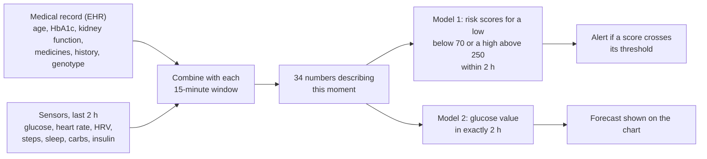

# GlycoTwin explained in plain language

A guide for readers without a machine-learning background: what GlycoTwin is, what it shows a doctor, how it works, how well it does, and what it cannot do.

> Synthetic data only. Research prototype, not a medical device. Not for diagnosis or dosing decisions.
> The numbers below come from [`../models/metrics.json`](../models/metrics.json), which `models/evaluate.py` writes.

---

## 1. The idea in one paragraph

Imagine driving at night and only being able to check the road behind you every few hours. Diabetes care can feel like that: a clinic visit every few months and occasional finger-prick checks. A continuous glucose monitor (CGM) shows the road behind you all the time, but someone still has to notice when it is curving towards trouble. GlycoTwin tries to look a little way ahead. Every 15 minutes it combines what is known about the person (their medical record) with what their sensors have just recorded, and estimates whether their glucose is likely to go **below 70 mg/dL** or **above 250 mg/dL** in the next 2 hours. It also gives a single best guess of the glucose value 2 hours from now.

We call it a "digital twin" because each patient's predictions are shaped by that patient's own record and recent data. It is a data-driven twin: a statistical model learned from data, not a mechanistic simulation of the body. A model-based "what if" (asking the trained model how its prediction changes if the meal or the walk were different) is the next step; today's What-If Sandbox uses simple hand-set rules instead.

---

## 2. Why it matters in India

- In 2021 an estimated **101 million people in India had diabetes** and **136 million had prediabetes** (ICMR-INDIAB-17, Anjana et al., *Lancet Diabetes Endocrinol* 2023). That figure counts diabetes found by testing, including people who did not yet know they had it.
- South Asian people tend to develop Type 2 diabetes at a lower body weight. One large study found that a BMI of about 23.9 in South Asian adults carried the same diabetes risk as a BMI of 30 in white adults (Caleyachetty et al., *Lancet Diabetes Endocrinol* 2021).
- Two short-term dangers:
  - **Low glucose (hypoglycaemia).** Below 70 mg/dL is "Level 1" and below 54 mg/dL is "Level 2" (American Diabetes Association). People can feel shaky, sweaty or confused, and severe lows can cause falls or loss of consciousness. In Type 2 diabetes, lows are mostly caused by sulfonylurea tablets (such as gliclazide or glimepiride) or insulin, especially when a meal is skipped, and they are more likely in older people.
  - **Very high glucose (marked hyperglycaemia).** Readings above 250 mg/dL. Spending a lot of time this high adds to long-term damage to the eyes, kidneys, nerves and heart. The international time-in-range consensus suggests most adults aim for more than 70% of readings between 70 and 180 mg/dL.

---

## 3. What the doctor sees

The Streamlit dashboard (`dashboard/app.py`) has five screens. The standalone web page (`dashboard/index.html`, hosted at https://glycotwin-app.web.app) has the same five screens for a few demo patients, with the model's outputs computed in advance. The two differ in some details, noted below.

| Screen | What it shows |
| :--- | :--- |
| **Live Monitor** | One patient: their record (age, medicines, HbA1c, kidney function and so on); charts of the last 8 hours of glucose and of the model's two risk scores; the current heart rate and HRV, steps (last 15 minutes, 1 hour and 2 hours), sleep stage, and carbohydrates and insulin logged in the last 2 hours; the current glucose and its trend, the 2-hour forecast and any alert. A time slider replays the 7 days of synthetic data in 15-minute steps. For patients the model never saw in training, it can also show what actually happened next, so you can judge the alert. |
| **What-If Sandbox** | "What if this meal were bigger, or followed by a walk?" A small set of hand-written rules draws a baseline curve and a "scenario" curve. It is **not** the machine-learning model and is not a dosing tool; it is for talking through lifestyle choices. The two dashboards use different rules. In Streamlit the baseline drifts back towards the patient's fasting glucose, and a meal raises glucose more for a higher BMI. On the standalone page the baseline is a straight line to the model's 2-hour forecast, and a walk lowers glucose more for people on a sulfonylurea or insulin. So the same scenario can give quite different curves on the two pages. |
| **Data Ingest** | Upload a CGM or wearable CSV file. It runs five checks (are the right columns there? are there gaps? are values in a plausible range? are there impossible jumps? how much is missing?). In the Streamlit app, a file in the full GlycoTwin format is also scored by the model. |
| **Cohort & Risk Board** | All 200 synthetic patients, ranked by the model's current risk scores, so the few who need attention now are at the top. |
| **Model Card** | How well the model did, how that was measured, and its limitations. |

What the alert says depends on the situation:

- **Glucose below 70 mg/dL right now.** The standard advice applies: 15 g of fast-acting carbohydrate, then recheck in 15 minutes (ADA "15-15 rule").
- **Low predicted but glucose still in range.** "Consider a snack and review medication timing with the care team."
- **High predicted.** A prompt to review the recent meal, missed doses and hydration with the care team.

GlycoTwin never suggests an insulin dose.

---

## 4. How it works, step by step



### Step 1: two kinds of information

- **Who the patient is (static).** 16 items from the record: age, gender, BMI, years with diabetes, HbA1c, fasting glucose, blood pressure, kidney function (eGFR), diet pattern, main medicine, insulin regimen, risk tier, number of lows in the past year, family history of diabetes, and a genetic marker (the TCF7L2 rs7903146 risk-allele count).
- **What is happening now (dynamic).** 18 items from the sensors and logs: current glucose and how fast it changed over the last 15 and 30 minutes, the average and spread of glucose over the last hour, heart rate and HRV now and over the last hour, steps over 15 minutes, 1 hour and 2 hours, carbohydrates and insulin now and over the last 2 hours, the hour of the day, and sleep stage (awake, light, deep or REM).

### Step 2: speed matters, not just the number

A glucose of 110 mg/dL means different things if it was 100 fifteen minutes ago (gently rising) or 160 (falling fast). That is why the model gets the recent change and the recent average as well as the current value.

### Step 3: the models

GlycoTwin uses **gradient-boosted decision trees** (scikit-learn's `HistGradientBoosting`). A decision tree asks a chain of yes/no questions, for example "Is glucose below 95? Is it falling? Is the patient on a sulfonylurea? Is it early morning?". Boosting builds many small trees one after another, and each new tree corrects the mistakes of the trees before it. There are two models:

1. **The event model** gives two risk scores: one for "a reading below 70 in the next 2 hours" and one for "a reading above 250 in the next 2 hours". An alert is raised when a score passes its threshold (0.51 for lows, 0.52 for highs). The thresholds were chosen using only the training patients, with catching events weighted above avoiding false alarms.
2. **The forecast model** predicts one glucose value, exactly 2 hours ahead. The Streamlit chart joins "now" to that point with a dotted straight line, which is only a visual connection, not a minute-by-minute prediction. The standalone page shows just the single 2-hour point, with error bars of about ±11 mg/dL (the average error on unseen patients).

The risk scores are **not** probabilities. Because events are rare, the model is trained to pay extra attention to them, which pushes the scores up. Read a score as "higher means more worrying, compared with the threshold", not as "a 0.8 score means an 80% chance".

### Step 4: honest testing

The 200 synthetic patients were split before training: 150 for training, and **50 the model never saw**. All the headline numbers come from those 50 unseen patients. As a second check, the whole process was repeated 5 times, each time training on a different 4/5 of all 200 patients and testing on the rest (cross-validation). The forecast error was about the same (11.08 mg/dL against 11.0), and so was the share of events caught. The share of alerts that were followed by an event (precision) was not: 37.1% in cross-validation against 52.3% on the 50 unseen patients for lows, and 51.8% against 36.4% for highs. Precision depends on how common the events are in the patients being tested, so it moves a lot between small groups of patients.

---

## 5. How well does it do? (on synthetic patients)

| Question | Answer on the 50 unseen patients |
| :--- | :--- |
| How close is the 2-hour forecast? | Off by **11.0 mg/dL** on average. Simply assuming "glucose stays the same" is off by 20.8 mg/dL. |
| How safe are the forecast errors? | 91.8% of forecasts are in Clarke Error Grid zone A (clinically accurate) and 7.6% in zone B (benign); 0.6% are in zone D (a dangerous miss: the forecast is in range while the real value is out of range). |
| Of the windows followed by a low, how many got a low alert? | **73%** (336 of 458). |
| Of the windows followed by a high, how many got a high alert? | **86%** (480 of 557). |
| Low episodes warned 15 to 120 minutes ahead | **34 of 39** (87%). |
| High episodes warned 15 to 120 minutes ahead | **42 of 43**. |
| How often does it alarm? | About **0.36 low alarms and 0.58 high alarms per patient per day**. |
| How many alarms are false? | **Most of them**: 69% of low alarms and 88% of high alarms were not followed by that event within 2 hours. |
| Is it better than a simple rule? | Yes. The rule "glucose below 90 and falling" flags 43% of the windows followed by a low (the model: 73%), and "above 200 and rising" flags 41% of the windows followed by a high (the model: 86%). |
| Does the medical record actually matter? | Yes, modestly. If each patient is given someone else's record, the forecast error rises from 11.0 to 16.1 mg/dL. Adding the record to the sensor data improves the forecast and low detection a little (cross-validated error 11.45 to 11.08 mg/dL). High detection is driven mainly by the sensors. |
| How fast is it? | About 15 milliseconds per 15-minute window on an ordinary CPU. |

Heart rate, HRV and sleep added little extra information in this synthetic data: removing them barely changed the results. The time of day helped a lot, because the simulated patients keep fairly regular routines.

---

## 6. What GlycoTwin cannot do (yet)

- **It has only seen synthetic patients.** The data comes from our own simplified simulator, which is not calibrated to real people. Good results here do not mean good results on real patients.
- **Too many false alarms** for real-world use as it stands; the thresholds would need tuning with clinicians.
- **No insulin users among the unseen patients.** Only 3 of the 200 synthetic patients use insulin, and all 3 were used for training.
- **The What-If Sandbox is a set of simple rules**, not the AI model. The Streamlit version uses only BMI and fasting glucose from the record (plus an insulin slider for insulin users). The standalone page's version uses the model's precomputed forecast and whether the patient takes a sulfonylurea or insulin. The two rule sets differ, and neither has been checked against real data.
- **It is not a medical device**, has not been clinically tested, and must not be used to make treatment or dosing decisions. Using it with real patients would need real-data validation, clinical trials and regulatory approval.
- **Privacy.** Because only synthetic data is used, no personal health data is processed (designed with DPDP Act 2023 principles in mind).

---

## 7. Try it

- Online (standalone page, a few demo patients): https://glycotwin-app.web.app. The same page is in the repository as `dashboard/index.html` and opens offline.
- On your own computer, from the repository root:

```bash
python -m venv .venv
source .venv/bin/activate          # Windows: .venv\Scripts\activate
pip install -r requirements.txt
streamlit run dashboard/app.py     # or: python run_dashboard.py
```

Patients worth opening (all unseen in training): **IND-PAT-196** and **IND-PAT-080** (sulfonylurea users with lows), **IND-PAT-077** and **IND-PAT-066** (post-meal highs), and **IND-PAT-046** (stable, no events).

---

## 8. In one sentence

GlycoTwin is a research prototype that combines a patient's medical record with their live sensor data to give a doctor a 2-hour early warning of low or very high glucose. On synthetic patients it catches most episodes in advance, at the cost of many false alarms, and it has not yet been tested on real people.
